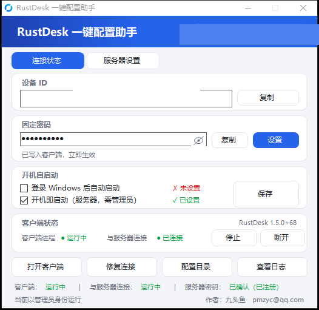

# RustDesk 一键配置助手（rustdesk-helper-cn）

> 一个**单文件、免安装**的 RustDesk 配置工具：三步完成服务器配置、固定密码设置与故障修复。专为国内自建 / 内网直连场景设计。

  

---

## 这是什么

RustDesk 官方客户端功能很强，但配置项分散在多个 TOML 文件里，`verification-method` 这类"不配就永远连不上"的隐藏门槛也让很多人栽跟头。这个助手把这些操作图形化，并且**只做配置，不魔改客户端**——它是外挂式的，删除助手不影响已配置好的 RustDesk。

**单文件 72 KB**，.NET Framework 4.0 自带于所有 Windows，无需安装运行时。



## 功能一览

- **三种使用模式**：官方公共服务 / 自建服务器 / 仅局域网，一键切换
- **固定密码**：一键生成并写入客户端（自动处理 `verification-method`，这是"密码怎么输都错"的元凶）
- **残留检测 + 彻底卸载**：进程、服务、7 个目录、5 处注册表、快捷方式、计划任务，逐项检测、逐项容错
- **运行方式可视化**：用户进程 / 系统服务一目了然，服务停止时不再误报红色
- **中继开关**：仅直连（强制 P2P）↔ 使用中继，一键切换
- **日志系统**：两种记录模式，自动裁剪防卡死
- **零依赖单文件**：WinForms 原生界面，无第三方库

---

## 三种使用模式

| 模式 | 配置 | 适用场景 | 注意 |
|---|---|---|---|
| **官方公共服务** | 全空 | 临时用、跨网络、不想折腾 | 官方中继有限速，商用建议自建 |
| **自建服务器** | 填地址 + Key | 有自己的 hbbs，要求速度与可控 | Key 必须与服务端 `id_ed25519.pub` 一致 |
| **仅局域网** | 全空 + `enable-lan-discovery='Y'` | 家里/公司同网段互连 | 只能连同一网段，跨网络不可用 |

切换模式时助手会自动重启客户端（RustDesk 只在启动时读配置，这一步不做配置永远不会生效）。

---

## ⚠️ 最重要的一个坑：固定密码

**症状**：固定密码明明设了，被控端却提示密码错误，怎么输都不对。

**原因**：RustDesk 1.5.x 要求 `verification-method` 明确声明。缺少这项时，客户端**只认随机一次性密码，固定密码完全不生效**。

**解决**：本助手写入的配置始终包含：

```toml
[options]
verification-method = 'use-both-passwords'
```

如果你是手动配置的，加上这一行就能解决。

**另外要知道**：在原生界面设置的固定密码，RustDesk 会以**加密形式**存进 `RustDesk.toml`（`password` + `salt`），没有明文，任何工具都读不回原文。本助手能检测出"客户端已设置过密码"（并如实提示加密不可读），但不会假装能显示它。点【设置】生成的新密码会以明文覆盖旧密码。

---

## 快速开始

1. 下载 `RustDeskHelper.exe`：[直接下载](https://github.com/pmzyc/rustdesk-helper-cn/raw/main/RustDeskHelper.exe)（也可在 [Releases](https://github.com/pmzyc/rustdesk-helper-cn/releases) 页面获取）
2. 确保已安装 RustDesk 客户端（[官方下载](https://rustdesk.com/zh/)）
3. 右键"以管理员身份运行"助手（部分功能需要）
4. 在【服务器设置】页选一个模式，点同步

### 首次使用推荐路径

```
打开助手
  ↓ 自动识别客户端已有配置（模式 / 密码 / 服务器），并在底部显示识别结果
  ↓ 未安装客户端时给出下载引导
  ↓ 选模式 → 同步 → 自动重启客户端 → 状态变"已连接"
```

---

## 编译

不需要 Visual Studio，用 Windows 自带的 csc 即可：

```powershell
# 需要同目录下有 rustdesk.exe（用于提取图标）
.\build.ps1
```

`build.ps1` 做的事：调用 `csc.exe` 编译单文件 → 从 `rustdesk.exe` 提取图标嵌入 → 输出 `RustDesk 一键配置助手.exe`。

源码是单个 `RustDeskHelper.cs`（约 4000 行），无外部依赖，想改就直接改。

---

## 已知限制

| 限制 | 说明 |
|---|---|
| **Windows 服务模式不可靠** | 1.5.x 的 `--service` 拉起的 `--server` 经常不启动连接线程（日志里连 `start udp` 都没有）。本助手已**统一改用用户进程模式**，服务模式相关功能保留但默认不启用 |
| **原生界面设置的密码读不出明文** | 加密存储（见上文），只能检测"已设置"状态 |
| **仅直连是硬限制** | 勾选后打洞失败就直接连不上，不会回退中继。同一虚拟网段（EasyTier/ZeroTier）内通常没问题 |
| **启动时若客户端未运行** | 助手会通过 explorer 降权拉起客户端，首次可能被 UAC 拦截 |

---

## FAQ

**Q：为什么我的固定密码总是错的？**
A：九成是缺 `verification-method = 'use-both-passwords'`。用本助手配置一次即可。

**Q：官方模式下 RustDesk 界面一直显示"未就绪，请检查网络连接"？**
A：这是 RustDesk 自身的 UI 误报——它用 `key_confirmed` 判断就绪，而官方服务器不做密钥确认。看助手的胶囊状态即可，显示"已连接 官方服务器"就是真的通了。

**Q：日志文件会不会越来越大？**
A：不会。超过 2MB 自动裁剪到最近 90 天、最多 3000 行。也可以在【日志】页切成"仅本次会话"模式。

**Q：卸载会删掉我助手里存的密码吗？**
A：不会。"彻底卸载"只清 RustDesk 的痕迹，助手自己的密码记录保留；想清空有单独的【清空助手数据】按钮。

---

## 目录结构

```
├── RustDeskHelper.cs    # 全部源码（单文件）
├── build.ps1            # 编译脚本（csc + 图标提取）
├── RustDeskHelper.exe   # 编译产物
└── README.md
```

---

## 免责声明

本工具只读写 RustDesk 官方配置文件，不修改客户端二进制。使用本工具产生的一切后果由使用者自行承担。RustDesk 是 [RustDesk 团队](https://github.com/rustdesk/rustdesk)的注册商标，本项目与之无隶属关系。

## License

MIT
