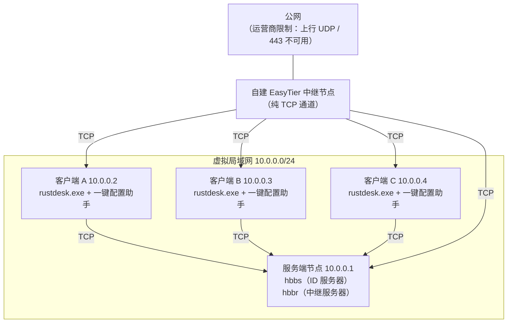

# 04 · EasyTier 纯 TCP 中继服务器说明

> 本文解释本工具诞生的**网络前提**：当运营商限制上行 UDP / 443 时，如何用 **EasyTier 去中心化组网 + 纯 TCP 中继**，把 RustDesk 服务端放进虚拟局域网，从而在恶劣网络下也能稳定远程。
> 客户端如何填写服务器地址见 [`03-局域网使用说明.md`](03-局域网使用说明.md)。

---

## 1. 为什么需要它

作者所在宽带被运营商（联通）**限制了上行 UDP 与 HTTPS(443) 流量**，直接后果有两个：

1. **官方服务器连不上**——连接 RustDesk 官方 rendezvous / relay 需要用到被限制的流量形态。
2. **P2P 打洞打不通**——打洞高度依赖 UDP，上行 UDP 被封后几乎无法建立直连。

既然 UDP 与 443 不可靠，就换一条**运营商没有封的、可用的 TCP 通道**，把分散在各地的机器**组进同一个虚拟局域网**，再把 RustDesk 服务端部署在这个虚网内部。这就是「EasyTier 纯 TCP 中继」方案的由来。

而官方 RustDesk 客户端在这个方案里还缺三件事（**开机自启 / 免登录桌面即可远程 / 注册修复**），这三件事正是 **RustDesk 一键配置助手**要补的——也就是说：**EasyTier 负责「把网络打通」，本工具负责「把 RustDesk 客户端伺候稳」。**

---

## 2. EasyTier 是什么、怎么工作

- **EasyTier** 是一套**去中心化**的异地组网工具：把分布在不同网络里的节点，通过**公共服务器 / 自建中继节点**牵线，组成一个**虚拟局域网**，节点之间像在同一局域网里一样互相通信。
- 它给每个节点分配一个**虚拟 IP**（在你自己划定的虚拟网段内，例如 `10.0.0.0/24`）。
- 节点之间**点对点直连**优先；直连打不通时，走**中继节点转发**。
- 因为是去中心化的，你可以**自建公共服务器 / 中继节点**——这在本场景里非常关键：你自建的中继可以**只开 TCP 端口**，完全绕开被封的 UDP。

> EasyTier 的安装与命令细节以其官方文档为准；本文只讲与本工具配套时**需要你关注的要点**。

---

## 3. 「纯 TCP 中继」模式的思路与要点

核心思路：**把运营商没封的 TCP 端口当作中继通道，尽量不依赖 UDP。**

要点：

1. **中继节点只开 TCP**：自建 EasyTier 中继节点时，把监听/转发配置成 TCP（或同时监听 TCP），避免依赖被封锁的 UDP。
2. **避免 UDP 依赖**：在组网参数里尽量显式走 TCP；对上层的 RustDesk，则在客户端配置里用 `disable-udp` 强制走 TCP（详见 [`03-局域网使用说明.md`](03-局域网使用说明.md) 第 3 节）。
3. **统一虚拟网段**：给所有节点规划好虚拟 IP（例如 `10.0.0.0/24`），并**固定**服务端节点的虚拟 IP（例如 `10.0.0.1`），这样客户端里的 ID 服务器地址就不用经常改。
4. **先打通再套应用**：先确认虚拟网内 `ping` 通、`Test-NetConnection` 端口通，再去配 RustDesk，层层验证，别混在一起排错。

> 抽象示例（**请以你的实际参数为准**，下列地址/网段均为**占位值**，不要照抄）：
>
> ```text
> 虚拟网段：   10.0.0.0/24
> 服务端节点： 10.0.0.1
> 客户端节点： 10.0.0.2 / 10.0.0.3 / 10.0.0.4 ...
> ```

---

## 4. 拓扑图：RustDesk 服务端部署在虚拟网内

### 4.1 ASCII 拓扑

```text
                       公网（受限：上行 UDP / 443 不可用）
                                  │
                ┌─────────────────┴─────────────────┐
                │      自建 EasyTier 中继节点        │
                │   （纯 TCP 通道，绕开被封的 UDP）   │
                └───────┬─────────────────────┬──────┘
                        │  TCP                │  TCP
        ┌───────────────┴──────────┐  ┌───────┴────────────────────────┐
        │  虚拟局域网 10.0.0.0/24    │  │                                │
        │                          │  │                                │
        │  ┌────────────────────┐  │  │  ┌────────────┐  ┌──────────┐  │
        │  │ 服务端节点          │  │  │  │ 客户端 A     │  │ 客户端 B  │  │
        │  │ 10.0.0.1           │◀─┼──┼─▶│ 10.0.0.2   │  │ 10.0.0.3 │  │
        │  │  hbbs(ID)          │  │  │  │ rustdesk   │  │ rustdesk │  │
        │  │  hbbr(中继)        │  │  │  │ + 本助手    │  │ + 本助手  │  │
        │  └────────────────────┘  │  │  └────────────┘  └──────────┘  │
        └──────────────────────────┘  └────────────────────────────────┘
                 客户端把 ID 服务器 / 中继服务器都指向 10.0.0.1
```

### 4.2 Mermaid 拓扑



- 客户端把 **ID 服务器 / 中继服务器**都指向服务端节点的**虚拟 IP**（示例 `10.0.0.1`）。
- 服务端 `hbbs` 监听 `21115/21116/21118`，`hbbr` 监听 `21117/21119`，并**只走 TCP**。

---

## 5. 免登录桌面即可远程

官方 RustDesk 客户端如果只是普通进程，**在 Windows 停在登录界面（没人登录桌面）时无法被远程**——因为此时客户端进程还没以「能接收连接的形态」跑起来。

解决办法：让 **RustDesk 以服务方式常驻**（Windows 服务 `RustDesk`，其子进程 `rustdesk.exe --server` 由服务自动拉起）。服务在系统启动早期就会运行，**不依赖桌面登录**，因此能实现「开机即可远程」。

本助手在这件事上负责：

- 用 **开机即启动** 计划任务（`RustDeskHelper-Boot`，`SYSTEM` 权限）保证开机早期就把助手拉起；
- 用 **登录后启动** 计划任务（`RustDeskHelper`）覆盖普通使用场景；
- 用面板上的【启动】确保**客户端进程**（`rustdesk.exe --tray`）也处于运行态，并提供【修复连接】在注册状态卡住时一键恢复。

> 注意区分：**「与服务器的连接」靠的是服务 `RustDesk` 的常驻**（保证免登录也能被控）；**「客户端进程」是前台/托盘的 `--tray` 进程**（方便日常查看 ID、快捷使用）。两者相互独立，详见 [`01-功能说明.md`](01-功能说明.md) 第 4.1 节。

---

## 6. 端口与连通性验证方法

推荐「**先虚网、后应用**」的分层验证：

### 6.1 验证虚拟网本身

```powershell
# 1) 先看虚拟网卡是否拿到虚拟 IP（例如 10.0.0.2）
ipconfig

# 2) 从客户端 ping 服务端虚拟 IP（例如 10.0.0.1）
ping 10.0.0.1
```

- `ping` 通 → 虚拟网层通了；
- `ping` 不通 → 先解决 EasyTier 组网（中继是否可达、节点是否在线、网段是否冲突），**不要**去折腾 RustDesk。

### 6.2 验证服务端端口

```powershell
# 在客户端测服务端 21116（ID 注册）是否可达
Test-NetConnection 10.0.0.1 -Port 21116

# 依次测 21115 / 21117 / 21118
Test-NetConnection 10.0.0.1 -Port 21115
Test-NetConnection 10.0.0.1 -Port 21117
Test-NetConnection 10.0.0.1 -Port 21118
```

- 关注输出里的 `TcpTestSucceeded : True/False`。
- 全为 `True` → 再去配置 RustDesk（ID 服务器 / 中继服务器 / Key）。
- 某个为 `False` → 检查服务端是否监听、防火墙 / 安全组是否放行该端口。

> 也可用 `telnet 10.0.0.1 21116`（需先启用 telnet 客户端功能）做同样的事。

---

## 7. 安全提示

- **Key 属于敏感信息**。它等同于你自建服务器的信任凭据，**不要提交到公开仓库**、不要贴进公开截图或聊天记录。
- **虚拟网段与真实 IP 不要外泄**。本文与仓库中所有地址均为**占位值**（如 `192.168.1.10`、`10.0.0.1`、`你的域名`），请勿套用真实值。
- 本工具的**公开版把默认服务器地址 / Key / API 全部留空**，正是为了避免把私人信息写死进代码。
- 若要发布自己的分支：把地址/Key 放在界面手填，或放在**不提交**的本地配置文件里，并确保 `.gitignore` 已排除相关文件（本仓库 `.gitignore` 已预留 `secrets.txt`、`*.key` 等规则）。
- 中继 / 服务端尽量只开放**必要的 TCP 端口**，并在云主机安全组上限制来源 IP 范围。

---

回到仓库根目录的 `README.md` 查看完整总览与快速开始。
